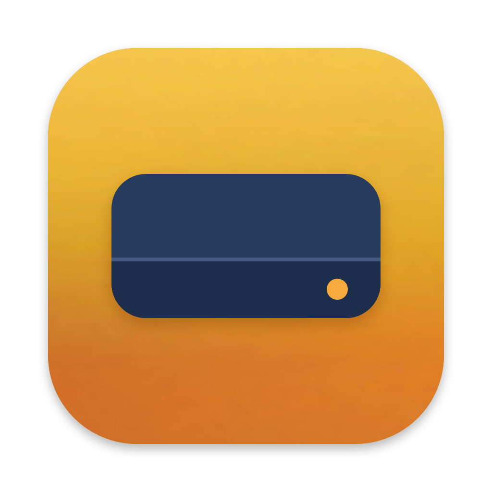
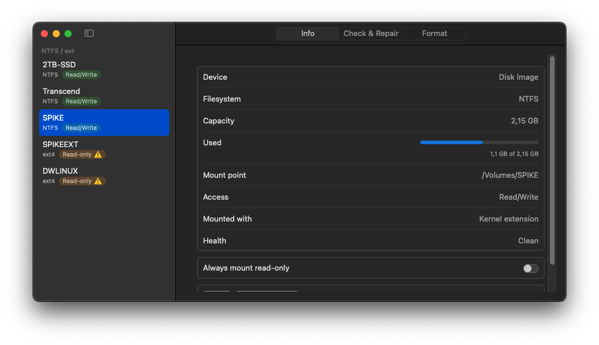
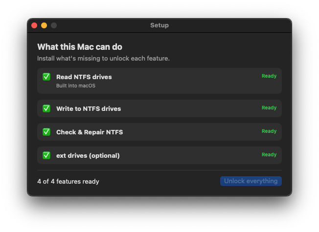
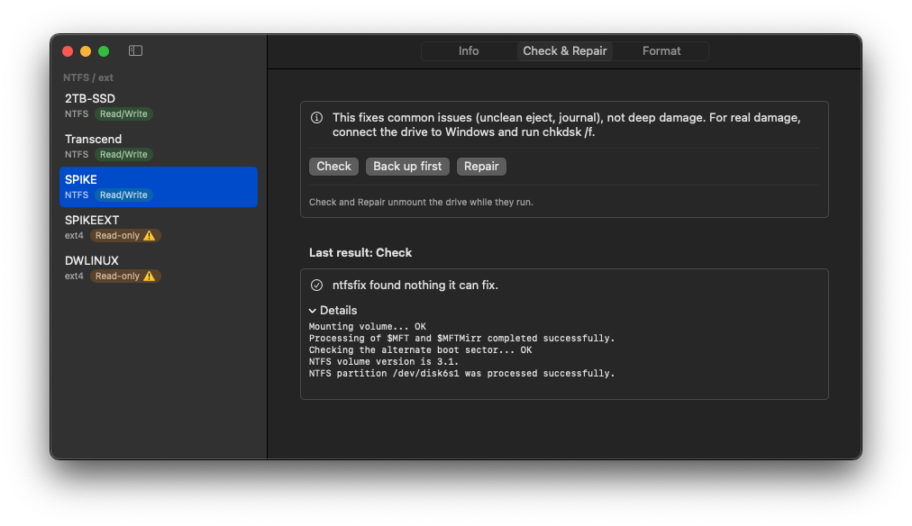
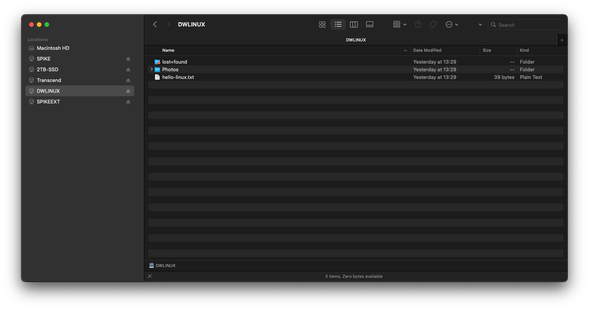

<p align="center">
  
</p>

<h1 align="center">Driveway</h1>

<p align="center">
  Use Windows (NTFS) and Linux (ext) drives on your Apple Silicon Mac.<br>
  Free and open source. No account, no licence key, nothing to buy.
</p>

<p align="center">
  <a href="https://fedar-piashko-vention.github.io/Driveway/"><b>Website</b></a>
  ·
  <a href="#install"><b>Install guide</b></a>
  ·
  <a href="https://github.com/fedar-piashko-vention/Driveway/releases/latest">Latest release</a>
  ·
  <a href="#questions-and-problems">Questions and problems</a>
</p>

<p align="center">
  
</p>

Macs can open drives formatted on Windows, but they can't save anything to them. Driveway is a free alternative to Tuxera NTFS for Mac and Paragon NTFS for anyone who can't buy them or doesn't want to pay for them. Plug in a drive and Driveway mounts it so you can copy, rename and delete files in Finder as usual. It can also check, repair, back up and format drives.

Driveway doesn't contain a filesystem driver of its own. It sets up and runs well-known free tools for you: [macFUSE](https://macfuse.github.io), [ntfs-3g](https://github.com/tuxera/ntfs-3g) and [e2fsprogs](https://e2fsprogs.sourceforge.net).

## Contents

- [What it does](#what-it-does)
- [What works on your Mac](#what-works-on-your-mac)
- [Install](#install)
- [Using Driveway](#using-driveway)
- [Questions and problems](#questions-and-problems)
- [Uninstall](#uninstall)
- [For developers](#for-developers)
- [Licence](#licence)

## What it does

- **Plug in and write.** NTFS drives mount read/write by themselves, whether or not the Driveway window is open. A drive that was already plugged in when you logged in is taken over within a few seconds.
- **Disk Manager.** One window lists your drives, with three tabs: **Info**, **Check & Repair** and **Format**.
- **Setup does the installing.** The Setup screen shows what your Mac can do, what's missing, and installs it for you.
- **Your files come first.** If Windows didn't shut a drive down properly, Driveway mounts it read-only and tells you, instead of writing to it and risking your files. One click, **Fix & mount read/write**, repairs it when you're ready.
- **Back up before a repair.** **Back up first** saves a complete copy of the drive to a file, with a progress bar.
- **Linux drives too.** ext2, ext3 and ext4 drives open read-only and show up in Finder's sidebar.

## What works on your Mac

What Driveway can do depends on your version of macOS and on your Mac's security settings. You don't need to work this out yourself: Setup checks your Mac and shows each feature as ready, missing something, or not available.

| | macOS 15, standard security | macOS 26 or later, standard security | Kernel extensions already allowed |
|---|---|---|---|
| See and copy files from NTFS drives | Yes | Yes | Yes |
| **Save files to NTFS drives** | **No** | **Expected, not yet tested** | **Yes** |
| Check & Repair, Back up first (NTFS) | Yes | Yes | Yes |
| Format as exFAT or FAT32 | Yes | Yes | Yes |
| Format as NTFS | No | Expected, not yet tested | Yes |
| Linux (ext) drives | No | Expected, not yet tested | Yes |

**Standard security** is how every Mac comes from the factory. You almost certainly have it unless you changed it yourself in Recovery.

**Kernel extensions already allowed** means that your Mac was set up earlier to accept third-party system extensions, usually because Tuxera, Paragon or another disk tool was installed on it at some point. If that's the case, Driveway can save files to NTFS drives on any supported macOS.

**Why macOS 15 can't save files with standard security.** On a Mac with standard security, macFUSE uses Apple's new FSKit system. FSKit is broken on recent macOS 15.7 updates: every attempt to mount a drive fails. Earlier 15.x versions haven't been tested, and Driveway tries FSKit there too. When Driveway sees this, Setup shows **Write to NTFS drives** as **Not available on this Mac yet**, and your drives stay readable as usual. Driveway tries again after each macOS or macFUSE update.

**macOS 26 and later.** macFUSE has fixed many FSKit problems on macOS 26 and 27, and Driveway uses FSKit automatically when it can. Nobody has tested Driveway on macOS 26 or later yet. If you have one of those versions:

- Try it first with a drive that has nothing important on it. Copy some files to it, eject it, and check that the files open on Windows.
- Driveway needs macFUSE 5.5.0 or later on these versions, and Setup offers the update if you have an older one. 5.5.0 works around a problem in FSKit on macOS 26 and 27 that could return wrong data when reading files.
- Please [tell us how it went](https://github.com/fedar-piashko-vention/Driveway/issues/new), whether it worked or not. That's how this table gets updated.

**Driveway never asks you to lower your Mac's security**, and it never changes security settings itself. Some guides explain how to allow kernel extensions in Recovery. That makes your Mac less protected, and it's your decision alone. This guide doesn't cover it.

## Install

The whole process takes about 20 minutes, most of it waiting for downloads. You need:

- a Mac with Apple Silicon (M1 or later)
- macOS 15.4 or later
- an administrator account (the one you set up the Mac with is one)
- an internet connection

> [!TIP]
> Not sure which Mac you have? Click the Apple menu  in the top-left corner and choose **About This Mac**. **Chip** should say Apple M1, M2, M3 or later, and **macOS** shows the version.

### Step 1. Remove Tuxera or Paragon, if you have them

If Tuxera NTFS for Mac or Paragon NTFS (or Paragon extFS) is installed, remove it first, using the uninstaller that came with it. These programs grab drives before Driveway can. Driveway never fights them for a drive: it leaves alone any drive they've mounted, and Setup warns you while one of them is installed.

If you've never installed them, skip this step.

### Step 2. Install Homebrew

[Homebrew](https://brew.sh) is a free tool that installs software from the command line. Driveway uses it to install macFUSE and ntfs-3g for you. You only need to do this once.

1. Open **Terminal**. It's in **Applications > Utilities**, or press ⌘ Space, type `Terminal` and press Return.
2. Copy this whole line, paste it into Terminal and press Return:

   ```bash
   /bin/bash -c "$(curl -fsSL https://raw.githubusercontent.com/Homebrew/install/HEAD/install.sh)"
   ```

3. When it asks for your **Password**, type the password you use to log in to your Mac and press Return. Nothing appears on screen while you type. That's normal.
4. When it says `Press RETURN/ENTER to continue`, press Return.
5. Wait. Homebrew may first install Apple's **Command Line Developer Tools**, which can take 10 minutes or more. It's finished when you see **Installation successful!**

At the end, Homebrew shows **Next steps** with a few more commands to copy. Driveway doesn't need them, but they're harmless, and you'll want them if you use Homebrew yourself later.

You can close Terminal now.

### Step 3. Install Driveway

1. Open **Terminal** again.
2. Copy this whole line, paste it into Terminal and press Return:

   ```bash
   /bin/bash -c "$(curl -fsSL https://raw.githubusercontent.com/fedar-piashko-vention/Driveway/main/scripts/install.sh)"
   ```

3. It downloads the latest version of Driveway, puts it in your **Applications** folder and opens it. If it asks for your **Password**, type the password you use to log in to your Mac and press Return.

Driveway opens with the Setup screen. To update Driveway later, run the same line again.

> [!NOTE]
> Why Terminal and not a normal download? Driveway is not signed with a paid Apple developer certificate. If you download it in a web browser, macOS says the app "is damaged and can't be opened", and offers no way to open it anyway. A file downloaded in Terminal doesn't get that check. The app isn't damaged: the warning is about how it's signed, not about what it does. All of Driveway's source code, including [the install script](scripts/install.sh), is in this repository for anyone to read. Whether to trust it is your choice.

<details>
<summary>Prefer to download it yourself?</summary>

1. Go to the [latest release](https://github.com/fedar-piashko-vention/Driveway/releases/latest) and click `Driveway-<version>.dmg` under **Assets** to download it.
2. Open the downloaded file and drag **Driveway** onto **Applications**.
3. Open **Terminal**, paste this line and press Return. It tells macOS that you trust this copy of Driveway:

   ```bash
   xattr -dr com.apple.quarantine /Applications/Driveway.app
   ```

4. Open Driveway from **Applications**.

</details>

Driveway has to run from the Applications folder. If you open it from anywhere else, it asks you to move it first.

### Step 4. Run Setup

<p align="center">
  
</p>

Setup lists four features: **Read NTFS drives**, **Write to NTFS drives**, **Check & Repair NTFS** and **ext drives (optional)**, and shows what each one still needs. Click **Unlock everything**. Setup then goes through what's missing, one item at a time:

1. **ntfs-3g, ext4fuse and e2fsprogs** install inside Setup, and you can watch the progress. One of them comes from a third-party Homebrew collection, so Homebrew asks you to confirm it. Setup shows the question and waits until you click **Continue**.
2. **macFUSE** installs in a Terminal window that Setup opens for you. Type your password there when asked. When it finishes, switch back to Driveway.
3. **macFUSE needs approval.** Setup shows **Needs approval** and an **Open Settings** button, which takes you to the right place in System Settings:
   - On most Macs, this is **General > Login Items & Extensions**. Find **File System Extensions** and turn on **macFUSE**.
   - On a Mac that already allows kernel extensions, it's **Privacy & Security**, where you click **Allow** for macFUSE. macOS may ask you to restart.
4. **The Driveway helper** installs after one password prompt. The helper is the small part of Driveway that works with your drives in the background.
5. **Full Disk Access.** macOS only lets a program work directly with an external drive if you give it Full Disk Access, which you do once:
   1. Click **Open Settings** next to the Full Disk Access step. System Settings opens at **Privacy & Security > Full Disk Access**.
   2. Click **+** at the bottom of the list and enter your password.
   3. Press **⌘ Shift G**, paste `/Library/PrivilegedHelperTools/app.driveway.helper.app` and press Return. Setup has a **Copy** button for this path.
   4. Click **Open**. **Driveway** (sometimes shown as `app.driveway.helper`) appears in the list. Make sure its switch is on.

When everything is done, Setup shows **Ready** next to each feature your Mac supports. On a Mac where saving to NTFS isn't possible yet (see [What works on your Mac](#what-works-on-your-mac)), **Write to NTFS drives** shows **Not available on this Mac yet**. That's expected.

### Step 5. Plug in a drive

Plug in an NTFS drive. Within a few seconds it appears on the desktop and in Finder's sidebar, ready to use. Open Driveway to see it in the Disk Manager.

Setup opens again by itself if something stops working later, for example after a macOS update. You can also open it any time from **Driveway > Setup…** in the menu bar.

## Using Driveway

### Every day

You don't need to open Driveway. Plug in a drive, use it in Finder, and **eject it before you unplug it**: in Finder, click ⏏ next to the drive, or use **Eject** in Driveway. Pulling a drive out without ejecting can lose the last files you copied, and Windows will then report the drive as needing a check.

### Disk Manager

<p align="center">
  
</p>

Open Driveway to see every external drive. Select one to see its tabs:

- **Info** shows the drive's capacity, filesystem, whether it's read/write, and who mounted it. It also has **Show in Finder**, **Eject**, and **Mount read/write** for an NTFS drive that's currently read-only.
- **Check & Repair** checks the drive for problems and fixes common ones, such as a drive that was unplugged without ejecting. **Back up first** saves a copy of the whole drive to a file before you repair it. **Repair (force)…** is the last resort: it removes anything it can't fix, so copy your files off first.
- **Format** erases a partition, or the whole disk, as exFAT, FAT32, NTFS or ext4. NTFS and ext4 are offered only when this Mac can use the result. It asks you to type the drive's name and your password, and it can't be undone.

Check & Repair and Format temporarily unmount the drive while they work. Don't unplug it until they finish.

### When a drive mounts read-only

Driveway sends a notification and explains why in the drive's **Info** tab:

- **Windows didn't shut this drive down cleanly.** This usually means the drive was unplugged from Windows without ejecting it. Click **Fix & mount read/write**. Driveway repairs it and mounts it read/write.
- **Windows is hibernating (Fast Startup).** Windows saved its open session on the drive. Saving files to it from the Mac would destroy that session, so there's no one-click fix. Start Windows, then **Shut down** (not Restart or Sleep) while holding **Shift**. To stop it happening again, turn off Fast Startup by running `powercfg /hibernate off` as administrator in Windows.
- **Full Disk Access is missing.** See [below](#driveway-asks-for-full-disk-access-again).
- **Another driver mounted it.** Tuxera or Paragon got to the drive first. Remove them (see [Step 1](#step-1-remove-tuxera-or-paragon-if-you-have-them)).

### Linux (ext) drives

ext2, ext3 and ext4 drives open read-only. They appear in Finder's sidebar like any other drive. Check & Repair and Format work with them too. Saving files to ext drives isn't supported yet.

<p align="center">
  
</p>

## Questions and problems

### Is Driveway really free?

Yes. It's open source under the MIT licence. There's no paid version, no trial and no account. The tools it relies on (macFUSE, ntfs-3g and e2fsprogs) are free too.

### Is it safe for my files?

Driveway is careful by design. It never writes to a drive that Windows left in an unfinished state without asking you first, it offers a backup before repairs, and it refuses to touch the disk your Mac runs from. Still, no tool is perfect, so keep a backup of anything important, as you would with any drive.

### My drive is read-only

Open Driveway and select the drive. The **Info** tab says why. The most common reasons:

- **Setup isn't finished**, or Setup says **Write to NTFS drives** is **Not available on this Mac yet**. See [What works on your Mac](#what-works-on-your-mac).
- **The drive is dirty or hibernated.** See [When a drive mounts read-only](#when-a-drive-mounts-read-only).
- **Full Disk Access is missing.** See the next question.
- **Tuxera or Paragon is still installed.** The Info tab names the driver that mounted the drive.

### Driveway asks for Full Disk Access again

macOS sometimes forgets the permission after Driveway updates, because the app isn't signed with a paid developer certificate. Setup then shows the Full Disk Access step again. In **System Settings > Privacy & Security > Full Disk Access**, select **Driveway**, click **−** to remove it, then add it again with **+** as in [Step 4](#step-4-run-setup).

### macOS says Driveway "is damaged and can't be opened"

You downloaded Driveway in a web browser. The app isn't damaged: macOS says this about apps that aren't signed with a paid Apple developer certificate. Click **Cancel**, not **Move to Bin**, then install Driveway with the Terminal line in [Step 3](#step-3-install-driveway). Or, if Driveway is already in Applications, paste this into Terminal and press Return:

```bash
xattr -dr com.apple.quarantine /Applications/Driveway.app
```

### How fast is it?

Fast enough for everyday copying, but slower than Tuxera or Paragon. ntfs-3g is a different kind of driver from theirs, and that's the trade-off for being free. Copying many small files is slower than copying a few large ones.

### Can Driveway fix a badly damaged drive?

Not always. Check & Repair uses `ntfsfix`, which fixes common problems but isn't a full replacement for Windows' `chkdsk`. For serious damage, connect the drive to a Windows PC and run `chkdsk /f`. Back up first.

### Does it work on Intel Macs?

It hasn't been tested on Intel Macs, and the download is built for Apple Silicon only.

### Something else went wrong

Please [open an issue](https://github.com/fedar-piashko-vention/Driveway/issues/new). It helps to include:

- your macOS version and Mac model (Apple menu  > **About This Mac**)
- what you did and what you expected to happen
- a screenshot of Setup, and of the drive's **Info** tab
- Driveway's log: run this in Terminal and attach the file it puts on your Desktop

  ```bash
  log show --last 1h --predicate 'subsystem BEGINSWITH "app.driveway"' > ~/Desktop/driveway-log.txt
  ```

## Uninstall

1. Open Driveway and choose **Driveway > Uninstall Driveway Helper…** in the menu bar, then confirm. This removes the helper and gives the app back to you.
2. Drag **Driveway** from Applications to the Trash.

Your settings stay in `/Library/Application Support/Driveway`, so a reinstall remembers your choices. Delete that folder to remove them too. macFUSE, ntfs-3g and the other tools stay installed. If you don't need them any more, remove them in Terminal:

```bash
brew uninstall --cask macfuse
```

```bash
brew uninstall ntfs-3g-mac ext4fuse-mac e2fsprogs
```

<details>
<summary>Removing the helper by hand, in Terminal</summary>

Use this if the app is already gone or the menu item doesn't work.

```sh
launchctl bootout "gui/$(id -u)/app.driveway.agent"
sudo launchctl bootout system/app.driveway.helper
sudo rm -f /Library/LaunchAgents/app.driveway.agent.plist \
           /Library/LaunchDaemons/app.driveway.helper.plist
sudo rm -rf /Library/PrivilegedHelperTools/app.driveway.helper.app \
            /Library/Filesystems/driveway_ext.fs /Library/Logs/Driveway
sudo chown -R "$USER" /Applications/Driveway.app   # installing the helper made the app root's
```

Without the last line, dragging Driveway to the Trash asks for an administrator password.

</details>

## For developers

### How it works

Driveway has three parts:

- **The app** runs as you. It shows Setup and the Disk Manager.
- **The helper** is a small program that runs as root, because ntfs-3g, `ntfsfix`, `mkntfs`, `e2fsck` and `mkfs.ext4` need raw access to the drive. On current macOS, raw access to an external drive also needs Full Disk Access. The helper watches for drives through Disk Arbitration and mounts them with ntfs-3g or ext4fuse on macFUSE. It only accepts requests from Driveway, asks for an administrator password before Format, Repair, Fix & mount and Back up, and refuses to touch the disk macOS runs from, any APFS or macOS system disk, and disk images (unless a developer setting allows them for testing).
- **The agent** runs in the background after you log in and shows notifications.

macFUSE has two ways to mount drives. Driveway uses the **kernel extension** on a Mac that already allows third-party kernel extensions, and **FSKit** otherwise. If FSKit fails on a macOS build, Driveway remembers that and shows writing as **Not available on this Mac yet** until macOS or macFUSE changes.

ntfs-3g runs with `norecover`, so it never clears the Windows journal on its own. A drive that ntfs-3g can only mount read-only is reported as dirty or hibernated, never shown as read/write. ext drives get a small filesystem bundle in `/Library/Filesystems`, which lets macOS recognise them and show them in Finder's sidebar.

The design choices and their trade-offs are summarised in [docs/spike-results.md](docs/spike-results.md).

### Building from source

You need an Apple Silicon Mac with macOS 15.4 or later and Xcode 26.3 or later (Swift 6.2).

```sh
swift test                         # unit tests
scripts/build-app.sh 0.1.0         # build/Driveway.app and build/Driveway-0.1.0.dmg
```

`build-app.sh` builds for arm64, assembles the app with its helper, agent and ext filesystem bundle, signs everything ad-hoc with the hardened runtime, and creates the dmg. The version must look like `1.2.3` or `1.2.3-rc1`.

The app icon is `Packaging/Driveway.icns`. It's rendered from the gradient in `Packaging/Icon/gradient-source.png` by `scripts/make-icon.swift`. To change it, edit either file, then run `scripts/make-icon.sh` and commit the new `.icns`.

The website is in `site/`. `scripts/build-site.sh` combines it with the screenshots from `docs/images` into `build/site`, and the Website workflow publishes it to GitHub Pages whenever `main` changes it. To preview it, run `scripts/build-site.sh` and then `python3 -m http.server --directory build/site`.

CI runs on GitHub's `macos-15` (Apple Silicon) runner and selects the Xcode 26.3 that the image ships. Pushing a tag that starts with `v` runs the release workflow, which tests, builds the dmg and attaches it to a GitHub release with the notes from `.github/release-notes.md`.

### Contributing

Bug reports, test results and pull requests are welcome.

- **Test reports are especially useful**, above all from macOS 26 or later. Say which macOS version, which macFUSE version, and whether saving files worked.
- For a pull request, run `swift test` first, and describe what you changed and how you tested it, including on a real drive if the change affects mounting.
- Keep the app's wording plain and short. Driveway is for people who aren't technical.

## Licence

[MIT](LICENSE). Driveway runs ntfs-3g, ext4fuse and e2fsprogs as separate programs rather than linking them. macFUSE has [its own licence](https://github.com/macfuse/macfuse/blob/master/LICENSE.txt), which doesn't allow bundling it, so Setup installs it from Homebrew.
